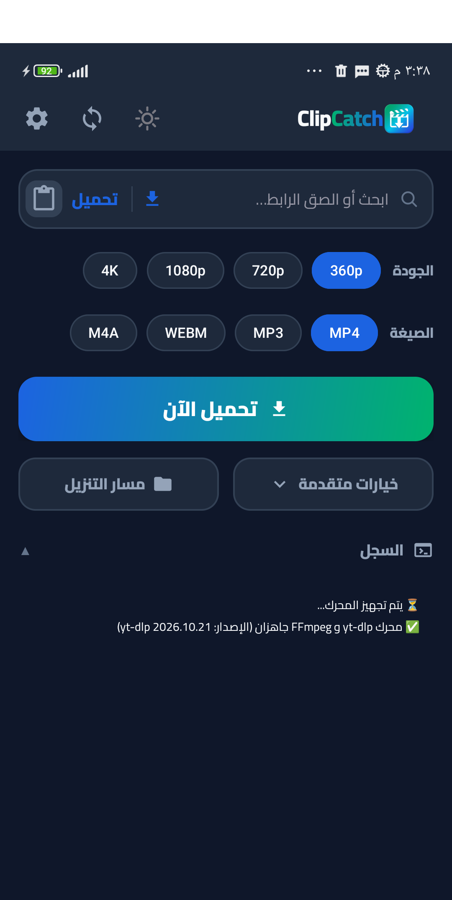
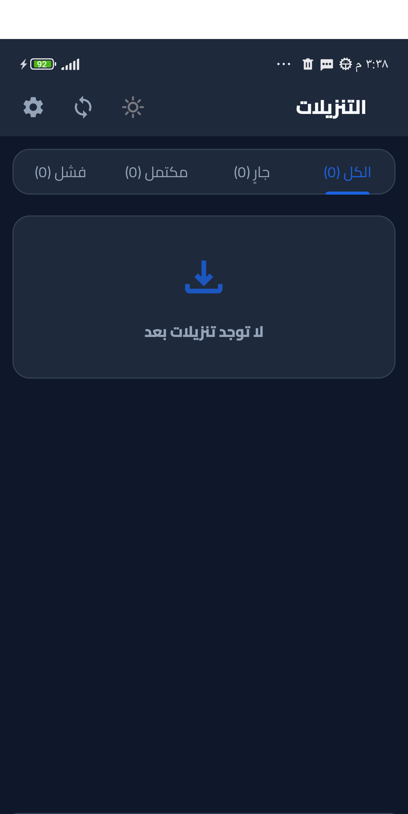
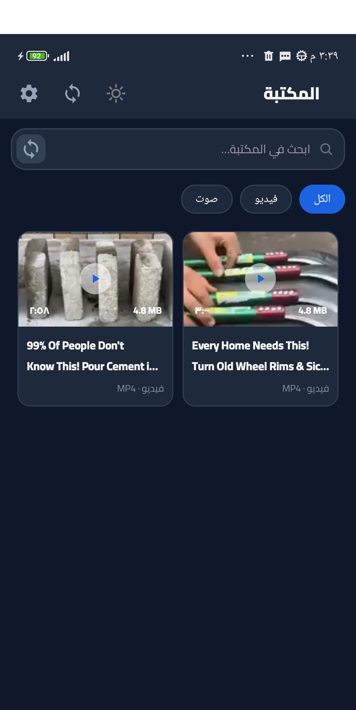
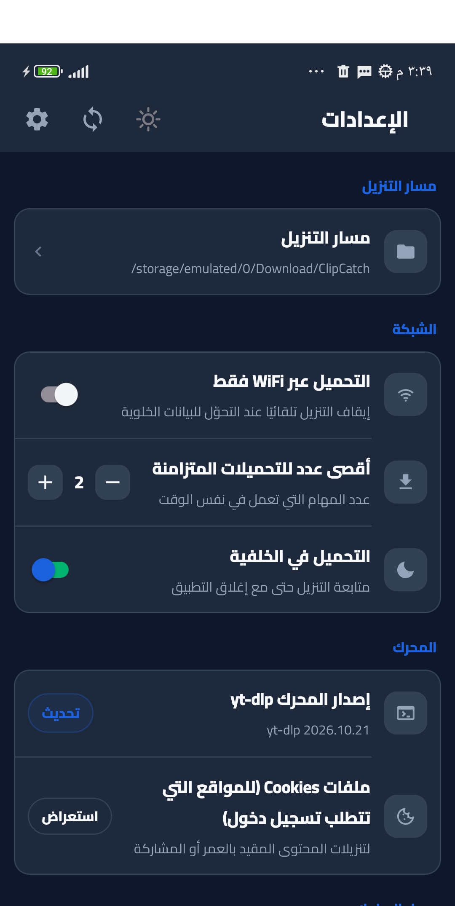

<div align="center">

# ClipCatch

**تطبيق أندرويد عربي لتحميل الفيديو والصوت من يوتيوب ومنصات أخرى — يعمل محليًا بالكامل على الجهاز.**


</div>

---

## المحتويات

- [نظرة عامة](#نظرة-عامة)
- [لقطات الشاشة](#لقطات-الشاشة)
- [المزايا](#المزايا)
- [المتطلبات](#المتطلبات)
- [البدء السريع](#البدء-السريع)
- [البناء من سطر الأوامر](#البناء-من-سطر-الأوامر)
- [توقيع نسخة الإصدار](#توقيع-نسخة-الإصدار)
- [طريقة الاستخدام](#طريقة-الاستخدام)
- [بنية المشروع](#بنية-المشروع)
- [كيف يعمل التطبيق](#كيف-يعمل-التطبيق)
- [التقنيات](#التقنيات)
- [الاختبارات](#الاختبارات)
- [استكشاف الأخطاء](#استكشاف-الأخطاء)
- [المساهمة](#المساهمة)
- [الترخيص وإخلاء المسؤولية](#الترخيص-وإخلاء-المسؤولية)
- [شكر وتقدير](#شكر-وتقدير)

---

## نظرة عامة

**ClipCatch** تطبيق أندرويد مفتوح المصدر لتحميل الفيديو والصوت، مبني على مكتبة [`youtubedl-android`](https://github.com/yausername/youtubedl-android) التي تغلّف محرك [`yt-dlp`](https://github.com/yt-dlp/yt-dlp).

يعمل التطبيق محليًا دون خادم وسيط: يجلب معلومات الفيديو، يعرض المعاينة والحجم الفعلي، ثم ينزّل الملف مباشرة إلى المجلد الذي تختاره. الواجهة عربية بالكامل وتدعم الاتجاه من اليمين إلى اليسار (RTL) مع وضع ليلي.

- **اسم التطبيق:** ClipCatch
- **معرّف الحزمة:** `com.ytdlpgui`
- **الحد الأدنى:** Android 7.0 (API 24)
- **الهدف:** Android 14 (API 34)

---

## لقطات الشاشة

<table>
  <tr>
    <td align="center" width="50%"><b>الرئيسية</b><br>
      </td>
    <td align="center" width="50%"><b>التنزيلات</b><br>
      </td>
  </tr>
  <tr>
    <td align="center" width="50%"><b>المكتبة</b><br>
      </td>
    <td align="center" width="50%"><b>الإعدادات</b><br>
      </td>
  </tr>
</table>

---

## المزايا

### المعاينة والتنزيل
- لصق رابط أو مشاركته من تطبيق آخر، فتظهر نافذة المعاينة تلقائيًا.
- عرض العنوان، القناة، المدة، والصورة المصغّرة قبل التنزيل.
- عرض **الحجم الفعلي** لكل جودة متاحة، مع تقدير الحجم عند تعذّر الحصول عليه.
- اختيار الجودة (أفضل جودة / 4K / 1080p / 720p / 360p...) والصيغة (فيديو أو صوت).
- حفظ الفيديو بصيغة MP4/WEBM والصوت بصيغة MP3/M4A.
- اختيار مجلد الحفظ عبر منتقي مجلدات النظام (SAF) أو استخدام المجلد الافتراضي.
- دعم قوائم التشغيل (Playlists) وتنزيل أكثر من عنصر.
- دعم ملفات تعريف الارتباط `cookies.txt` للفيديوهات المقيّدة أو الخاصة.

### إدارة التنزيلات
- طابور تنزيلات مع حالات واضحة: في الانتظار، جارٍ، متوقف مؤقتًا، مكتمل، فشل، ملغى.
- شريط تقدم مع النسبة، السرعة، الوقت المتبقي، والحجم الكلي/المنزّل.
- إيقاف مؤقت، استئناف، إلغاء، وإعادة محاولة.
- إشعار تقدم دائم عبر خدمة أمامية (Foreground Service) أثناء التنزيل.
- كشف العناصر المكتملة مسبقًا لمنع التنزيل المكرر.
- حفظ سجل التنزيلات في قاعدة بيانات محلية (Room) مع مسار الملف وحجمه.

### المكتبة والإعدادات
- مكتبة وسائط تعرض الملفات المنزّلة مع النوع، الامتداد، المدة، والحجم.
- بحث وتصفية، وتشغيل/مشاركة/حذف الملف.
- الوضع الليلي/النهاري.
- تحديث محرك yt-dlp من داخل التطبيق.
- واجهة عربية RTL بتصميم Material 3.

---

## المتطلبات

| المكوّن | الإصدار المطلوب |
|---|---|
| Android Studio | أحدث إصدار مستقر يدعم Android Gradle Plugin 8.10 |
| JDK | 17 |
| Android SDK Platform | API 34 (Android 14) |
| Android SDK Build-Tools | الإصدار الافتراضي المرافق لـ API 34 |
| Gradle | 8.11.1 (مضمّن عبر Gradle Wrapper) |
| Kotlin | 1.9.22 |
| جهاز/محاكي | Android 7.0 (API 24) أو أحدث |

> تأكد من ضبط **Gradle JDK** على JDK 17 من:
> `Settings → Build, Execution, Deployment → Build Tools → Gradle → Gradle JDK`.

---

## البدء السريع

### 1. استنساخ المشروع

```bash
git clone https://github.com/EngAlaaJahaf/yt-dlp-Android.git
cd yt-dlp-Android
```

### 2. الفتح في Android Studio

1. افتح Android Studio.
2. اختر **File → Open** وحدّد **مجلد المشروع** نفسه (المجلد الذي يحتوي على `settings.gradle.kts` وليس مجلد `app`).
3. انتظر انتهاء مزامنة Gradle (**Sync Project with Gradle Files**).
4. إذا طلب Android Studio تنزيل مكوّنات ناقصة، اضغط **Install missing platform(s) and sync project** وثبّت **Android SDK Platform 34**.
5. وصّل هاتفًا مفعّل عليه **USB Debugging** أو شغّل محاكيًا (Emulator).
6. اضغط زر **Run ▶** لتثبيت التطبيق وتشغيله.

لبناء ملف APK من داخل Android Studio:

```
Build → Build Bundle(s) / APK(s) → Build APK(s)
```

مسار الناتج:

```
app/build/outputs/apk/debug/app-debug.apk
```

---

## البناء من سطر الأوامر

### Windows

```bat
gradlew.bat assembleDebug
```

### Linux / macOS

```bash
chmod +x gradlew
./gradlew assembleDebug
```

لتشغيل الاختبارات:

```bat
gradlew.bat testDebugUnitTest
```

لبناء نسخة الإصدار (يتطلب إعداد التوقيع أولًا — انظر القسم التالي):

```bat
gradlew.bat assembleRelease
```

مسار ملف APK النهائي:

```
app/build/outputs/apk/release/app-release.apk
```

> **ملاحظة:** أول عملية بناء قد تستغرق عدة دقائق لأن Gradle ينزّل التبعيات ومكوّنات yt-dlp/FFmpeg.

---

## توقيع نسخة الإصدار

نسخة `release` تحتاج مفتاح توقيع. أنشئ ملف `keystore.properties` في **جذر المشروع** (وهو مستبعد من Git ولن يُرفع):

```properties
storeFile=مسار/ملف/release-key.jks
storePassword=كلمة_المرور
keyAlias=clipcatch
keyPassword=كلمة_المرور
```

- يمكن أن يكون `storeFile` مسارًا مطلقًا أو نسبيًا إلى مجلد `app/`.
- لإنشاء مفتاح جديد:

```bash
keytool -genkeypair -v -keystore release-key.jks -alias clipcatch -keyalg RSA -keysize 2048 -validity 10000
```

> **تحذير:** لا ترفع `release-key.jks` أو `keystore.properties` إلى المستودع. الملفات مستبعدة مسبقًا في `.gitignore`.

---

## طريقة الاستخدام

1. افتح التطبيق، ثم الصق رابط الفيديو في حقل الرابط أو استخدم زر **لصق**.
   يمكنك أيضًا مشاركة رابط من تطبيق آخر واختيار **ClipCatch**.
2. تظهر نافذة المعاينة تلقائيًا مع العنوان والحجم والجودات المتاحة.
3. اختر الجودة والصيغة، وتأكد من مجلد الحفظ من الإعدادات إن لزم.
4. اضغط **تحميل**، وتابع التقدم من تبويب **التنزيلات**.
5. بعد الاكتمال يظهر الملف في تبويب **المكتبة**، حيث يمكنك تشغيله أو مشاركته أو حذفه.
6. من **الإعدادات** يمكنك تغيير مجلد الحفظ، تفعيل الوضع الليلي، استيراد `cookies.txt`، أو تحديث محرك yt-dlp.

---

## بنية المشروع

```text
yt-dlp-Android/
├── app/
│   ├── build.gradle.kts
│   ├── proguard-rules.pro
│   └── src/
│       ├── main/
│       │   ├── AndroidManifest.xml
│       │   ├── java/com/ytdlpgui/
│       │   │   ├── MainActivity.kt
│       │   │   ├── SettingsActivity.kt
│       │   │   ├── data/
│       │   │   │   ├── bus/        # ناقل أحداث حالة التنزيل
│       │   │   │   ├── db/         # Room: قاعدة التنزيلات
│       │   │   │   ├── engine/     # تغليف yt-dlp والتحقق من الأوامر
│       │   │   │   ├── model/      # نماذج البيانات وتنقية الروابط
│       │   │   │   ├── settings/   # DataStore للإعدادات
│       │   │   │   └── storage/    # التعامل مع SAF والمجلدات
│       │   │   ├── service/        # DownloadService (Foreground)
│       │   │   └── ui/             # الشاشات: الرئيسية، التنزيلات، المكتبة، الإعدادات
│       │   └── res/                # التخطيطات، الألوان، النصوص، الأيقونات
│       └── test/java/com/ytdlpgui/ # اختبارات الوحدة
├── gradle/wrapper/
├── build.gradle.kts
├── settings.gradle.kts
└── README.md
```

---

## كيف يعمل التطبيق

1. **إدخال الرابط:** تقوم `MainViewModel` بتنقية الرابط والتحقق منه، ثم تطلب معلومات الفيديو من المحرك.
2. **المعاينة:** يعرض `DownloadEngine` بيانات yt-dlp (العنوان، الجودات، الأحجام)، وتُعرض في نافذة المعاينة.
3. **الطابور:** عند بدء التنزيل يُسجَّل الطلب في Room وتُشغَّل `DownloadService` كخدمة أمامية.
4. **التنفيذ:** يشغّل المحرك yt-dlp مع FFmpeg لدمج الصوت والصورة، ويقرأ مخرجات التقدم سطرًا بسطر.
5. **التحديث الحي:** تُبث أحداث التقدم عبر `DownloadStateBus` إلى الواجهة، وتُحدَّث قاعدة البيانات دوريًا.
6. **الاكتمال:** يُحفظ المسار النهائي وحجم الملف في قاعدة البيانات، ويظهر العنصر في المكتبة.

---

## التقنيات

- **اللغة:** Kotlin 1.9.22
- **البناء:** Android Gradle Plugin 8.10.1 / Gradle 8.11.1
- **الواجهة:** Material Components 3، ViewBinding، ViewModel + Lifecycle
- **التدفقات:** Kotlin Coroutines وFlow/StateFlow
- **التخزين:** Room 2.6.1 (سجل التنزيلات) وDataStore (الإعدادات)
- **المحرك:** youtubedl-android 0.18.1 + FFmpeg + yt-dlp
- **التخزين الخارجي:** Storage Access Framework (SAF) وFileProvider
- **المعمارية:** MVVM مع فصل الطبقات (`data` / `service` / `ui`)
- **ABI:** `armeabi-v7a` و`arm64-v8a`

---

## الاختبارات

توجد اختبارات وحدة تغطي المنطق الأساسي:

| الاختبار | ما يتحقق منه |
|---|---|
| `UrlSanitizerTest` | تنقية الروابط واستخراج المعرّف |
| `YtdlCommandBuilderTest` | بناء أوامر yt-dlp بشكل صحيح |
| `FormatSizeEstimatorTest` | تنسيق الأحجام وتقديرها |
| `ErrorClassifierTest` | تصنيف أخطاء التنزيل ورسائلها |
| `RequestCodecTest` | ترميز/فك ترميز طلبات التنزيل |
| `PlaylistParserTest` | تحليل قوائم التشغيل |
| `MainViewModelTest` | حالات الواجهة ومنطق الطابور |

التشغيل:

```bat
gradlew.bat testDebugUnitTest
```

تقرير الاختبارات:

```
app/build/reports/tests/testDebugUnitTest/index.html
```

---

## استكشاف الأخطاء

| المشكلة | الحل |
|---|---|
| فشل مزامنة Gradle | تأكد من JDK 17 ومن تثبيت Android SDK Platform 34، ثم أعد المزامنة. |
| `SDK location not found` | أنشئ ملف `local.properties` يحتوي على `sdk.dir=مسار/Android/Sdk` أو اضبطه من Android Studio. |
| فشل بناء `release` | تأكد من وجود `keystore.properties` صالح في جذر المشروع. |
| فشل التنزيل برسالة شبكة | حدّث محرك yt-dlp من الإعدادات، تحقق من الاتصال، وجرّب شبكة أخرى. |
| فيديو خاص/مقيّد لا يُنزَّل | استورد ملف `cookies.txt` من الإعدادات. |
| التنزيل يتوقف في الخلفية | اسمح بالإشعارات، وأوقف تحسين البطارية للتطبيق من إعدادات النظام. |
| الملف لا يظهر في المكتبة | اضغط تحديث، وتأكد من مجلد الحفظ في الإعدادات ومنح صلاحية التخزين. |
| `INSTALL_FAILED_UPDATE_INCOMPATIBLE` | أزل النسخة القديمة أولًا إذا اختلف توقيع APK. |
| مساحة غير كافية | تحقق من المساحة المتاحة في مجلد الحفظ. |

---

## المساهمة

المساهمات مرحّب بها:

1. اعمل Fork للمستودع.
2. أنشئ فرعًا جديدًا: `git checkout -b feature/اسم-الميزة`.
3. نفّذ التغييرات وأضف اختبارات عند الحاجة.
4. تأكد من نجاح البناء والاختبارات: `gradlew.bat testDebugUnitTest assembleDebug`.
5. افتح Pull Request مع وصف واضح للتغيير.

---

## الترخيص وإخلاء المسؤولية

- لا يوجد ملف ترخيص (`LICENSE`) مستقل لهذا المستودع حتى الآن. قبل إعادة استخدام الكود أو توزيعه، راجع تراخيص المكتبات التابعة.
- يعتمد التطبيق على [`youtubedl-android`](https://github.com/yausername/youtubedl-android) (GPL-3.0) و[`yt-dlp`](https://github.com/yt-dlp/yt-dlp) و[FFmpeg](https://ffmpeg.org/)؛ لكل منها ترخيصه الخاص.
- استخدم التطبيق فقط لتحميل المحتوى الذي تملك حق الوصول إليه أو تحميله، واحترم شروط خدمة المنصات وحقوق النشر.

---

## شكر وتقدير

- [yt-dlp](https://github.com/yt-dlp/yt-dlp) — محرك استخراج وتنزيل الوسائط.
- [youtubedl-android](https://github.com/yausername/youtubedl-android) — تغليف yt-dlp لأندرويد.
- [FFmpeg](https://ffmpeg.org/) — دمج وتحويل الصيغ.
- [Material Design](https://m3.material.io/) — نظام التصميم.
